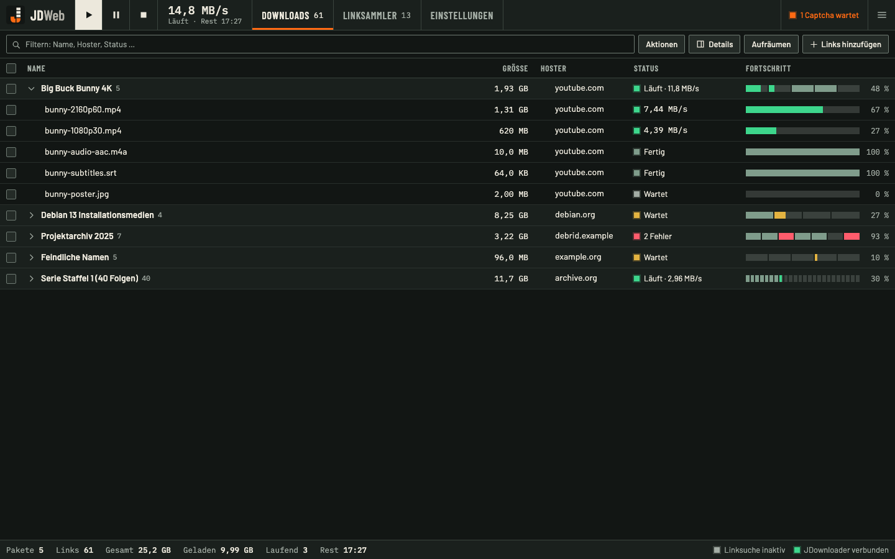
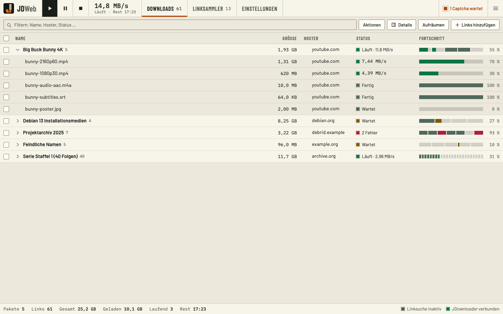
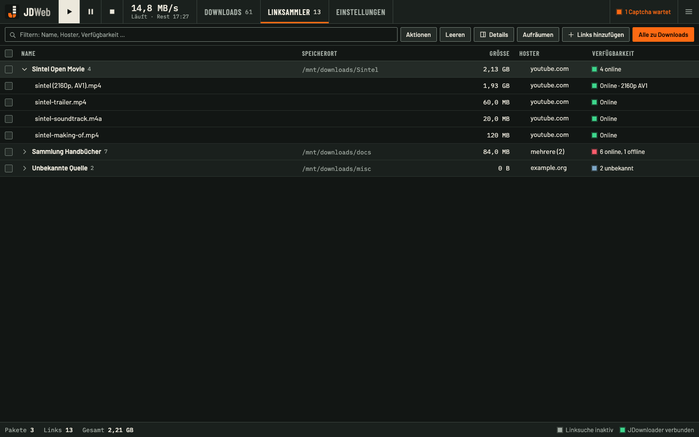
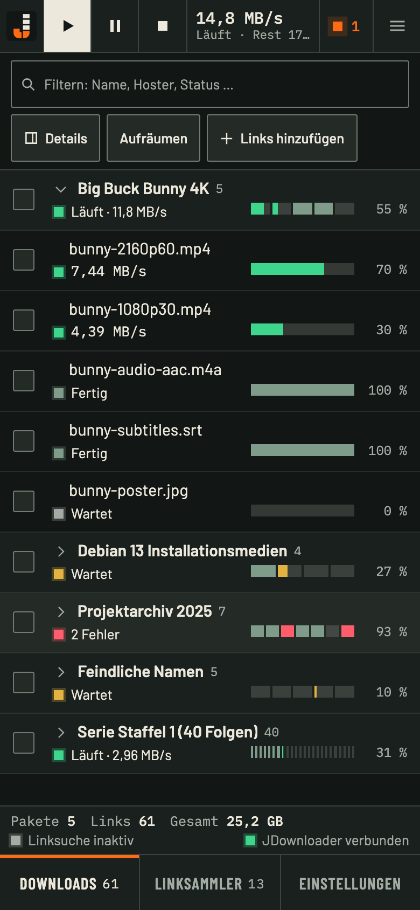

<p align="center">
  <picture>
    <source media="(prefers-color-scheme: dark)" srcset="web/public/jdweb-logo-dark.svg">
    
  </picture>
</p>

<p align="center">
  A fast, self-hosted web interface for <a href="https://jdownloader.org">JDownloader</a>.<br>
  One small container. No cloud account. No outside connections.
</p>

> **Unofficial.** JDWeb is an independent project. It is not made, endorsed or supported by AppWork GmbH and has no affiliation with them. "JDownloader" is a name of AppWork. JDWeb contains no code from JDownloader or from my.jdownloader.org. Use it at your own risk (see [License](#license)).

## What it is

JDWeb talks to the API of your own JDownloader over your own network and gives you a web app for it: live downloads, the link grabber, captchas, settings. It replaces the cloud detour through my.jdownloader.org for people who run JDownloader at home, for example in Docker on Unraid.

- **Downloads** with live progress, packages and links, start, stop and pause, priority, rename, reorder by drag and drop, cleanup, filter and sort. Handles thousands of links (virtual scrolling).
- **Link grabber**: add links or container files, pick variants, check availability, move to downloads.
- **Captchas and questions** from JDownloader, in the browser: image captchas, skip, answer dialogs.
- **Extraction, hoster accounts, settings**, including all advanced settings, plugins and extensions.
- **Live** through server-sent events. JDownloader restarts? The page shows it, heals itself and catches up.
- **Safe by default** (JDWeb's own login and page; for JDownloader's API see [Security](#security-read-this)): account with Argon2id password, optional two-factor (TOTP), setup only with a one-time token, CSRF checks, strict CSP, no third-party resources, fonts inside the image.
- **Small**: image about 15 MB, about 6 MB of RAM at idle. Dark and light mode, phone layout, German and English by browser language.

| | |
|---|---|
|  |  |
|  |  |

The screenshots show sample data only (the interface follows the browser language, here German).

## Before you start: two settings in JDownloader

JDownloader's old API is switched off by default. JDWeb needs it. This is the only change to JDownloader, and its network, IP address and Docker settings stay as they are. Be aware that it opens JDownloader's API, which has no login, to the network: see [Security](#security-read-this).

In JDownloader open **Settings, Advanced Settings** (in the `jlesage` image this is the web interface on port 5800) and set:

| Key | Value |
|---|---|
| `RemoteAPIConfig: Deprecated Api Enabled` | `true` |
| `RemoteAPIConfig: Deprecated Api Localhost Only` | `false` |

Then **restart JDownloader**. (With the [shared network option](#option-b-share-jdownloaders-network) below, `Localhost Only` may stay `true`; `Deprecated Api Enabled` is always required.)

## Security: read this

> **JDownloader's API has no login.** Whoever can reach its address and port (3128 by default) can control JDownloader completely: start and stop downloads, add and delete links, change settings, restart it. JDWeb adds a login for *its own* page, but it cannot close JDownloader's port. After the two settings above, port 3128 is open to everything that can reach JDownloader's address. In a home network that is every device in it. A web page open in your browser can also trigger actions with a plain request if it knows the address.

This is a deliberate trade-off of JDWeb: it leaves JDownloader's network untouched. JDWeb's setup check tells you the same. If that is too open for you, there are two ways to tighten it:

### Option A: a network of their own

Put JDownloader and JDWeb in a Docker network that only they share, and publish only JDownloader's web port (5800) and JDWeb's port (7468). Do **not** publish 3128. The [Compose example](#docker-compose) does exactly this. Containers in other networks cannot reach the API then. On Unraid this means moving JDownloader to a new network, which changes its IP address; that is why the Unraid template does not require it.

### Option B: share JDownloader's network

JDWeb joins the network of the JDownloader container (`--network container:<name>`). The API stays on `127.0.0.1` inside it, so nothing else can reach it, and JDownloader's IP and network stay as they are.

- On Unraid: set the JDWeb **Network Type** to `None`. In **Extra Parameters** keep what the template put there and append `--net=container:<JDownloader container name>` at the end. Set `JDWEB_JD_URL=http://127.0.0.1:3128`. Port 7468 must then be published on the **JDownloader** container (ports belong to the network owner): add a Port mapping `7468` there.
- `Deprecated Api Localhost Only` can stay `true`.
- **Caveat:** JDWeb is tied to that one container instance. After a `docker restart` of JDownloader the connection is gone and JDWeb must be restarted too. After JDownloader is recreated (for example by an update) JDWeb must be recreated as well. A restart of JDownloader from inside its own app is fine.

If JDownloader runs on another device (desktop), the API is open to the whole network; limit port 3128 to the address of JDWeb with a firewall rule.

### HTTPS

JDWeb speaks plain HTTP. On a trusted home network that is acceptable, but password and session cookie can then be read by anyone on the same network, and browsers offer installable web apps and notifications only on HTTPS. For HTTPS put JDWeb behind your reverse proxy or use [Tailscale Serve](https://tailscale.com/kb/1312/serve), and set `JDWEB_TRUSTED_PROXIES` to the proxy's address so that `X-Forwarded-*` is believed and the cookie gets the `Secure` flag.

## Install on Unraid

1. Do the [two JDownloader settings](#before-you-start-two-settings-in-jdownloader) and restart JDownloader.
2. Get the template. In the Unraid terminal:

   ```sh
   wget -O /boot/config/plugins/dockerMan/templates-user/my-JDWeb.xml \
     https://raw.githubusercontent.com/Buffer379x/jdweb/main/deploy/jdweb.xml
   ```

3. **Docker**, **Add Container**, pick the template **JDWeb**.
4. **Network Type**: one that can reach JDownloader (the same network JDownloader uses is the safe choice). If JDownloader has its own address on `br0` or another macvlan network, a container in the `bridge` network cannot reach it unless **Settings, Docker, "Host access to custom networks"** is on; the simplest fix is to put JDWeb on the same `br0` network.
5. **JDownloader address**: `JDWEB_JD_URL` = `http://<JDownloader-IP>:3128`. In a custom network both containers share, `http://<container-name>:3128` works too.
6. Keep **Data** on the cache or a pool: `/mnt/cache/appdata/jdweb`, not `/mnt/user/...` (FUSE is a risk for SQLite).
7. **Apply.** Open the container's **Logs** and copy the one-time **setup token**. Open the WebUI, enter the token and create your account. The setup check then confirms the connection or names the fix.

The template starts the container as root (`--user 0:0`, read-only file system, no new privileges, 256 MB memory limit). JDWeb gives `/data` to `PUID:PGID` (99:100 = `nobody:users`) and drops root before it opens the database, so folders that Docker created as root just work.

## Docker Compose

[`compose.yaml`](compose.yaml) runs JDownloader and JDWeb in a network `jdnet` of their own (recommended for fresh installs, see [Option A](#option-a-a-network-of-their-own)):

```sh
docker compose up -d
docker compose logs jdweb      # the setup token is in here
```

Do the two JDownloader settings once JDownloader has started for the first time, restart it, then open `http://<host>:7468`. The image runs as `99:100`, read-only, without capabilities; the named volume takes its owner from the image.

Plain `docker run`:

```sh
docker run -d --name jdweb --read-only --cap-drop ALL --security-opt no-new-privileges:true \
  -p 7468:7468 -e JDWEB_JD_URL=http://<JDownloader-IP>:3128 -v jdweb-data:/data \
  ghcr.io/buffer379x/jdweb:0.1.0
```

Images: `ghcr.io/buffer379x/jdweb:<version>` and `:latest`, for `linux/amd64` and `linux/arm64`.

## Configuration

| Variable | Default | Purpose |
|---|---|---|
| `JDWEB_JD_URL` | `http://jdownloader:3128` | Address of JDownloader. An address saved in the web interface wins over the variable. |
| `JDWEB_LISTEN` | `:7468` | Address and port to listen on. |
| `JDWEB_DATA_DIR` | `/data` | Data folder (database `jdweb.db`). |
| `JDWEB_TRUSTED_PROXIES` | empty | Reverse proxies (address or CIDR, comma separated) whose `X-Forwarded-*` headers are believed. |
| `JDWEB_LOG_LEVEL` | `info` | `debug`, `info`, `warn` or `error`. |
| `PUID`, `PGID` | `99`, `100` | Owner of `/data` when the container starts as root. |
| `TZ` | `UTC` | Time zone of the log. |

## Forgot your password?

```sh
docker exec jdweb /jdweb reset-password
```

It prints a one-time token (valid for an hour). Open JDWeb: it shows the setup page again; enter the token and a new password. The user name stays, two-factor is switched off and all sessions end.

## Backup and updates

- **Backup:** the folder `/data`. It holds only the account, sessions and settings, nothing you could not set up again. Stop the container before you copy it.
- **Update:** pull the new image tag and recreate the container. Migrations run at start, and JDWeb keeps the last three `jdweb.db.pre-<version>` copies. A downgrade to a version with an older schema is refused with a clear message.

## Development

Needs Go 1.27, Node 24 and pnpm 10 (see `web/package.json`).

```sh
pnpm --dir web install --frozen-lockfile
pnpm --dir web build                 # writes web/dist, which the Go binary embeds
go test -race ./...
go run ./cmd/jdweb serve             # then open http://localhost:7468
pnpm --dir web dev                   # Vite dev server, proxies /api to :7468
```

- `docs/api.md` is the contract between backend and web app.
- `scripts/teststack.sh up` starts a throwaway JDownloader with a fixture server for tests.
- `docker build -t jdweb:dev . && scripts/smoke-test.sh jdweb:dev` builds the image and checks it (size, read-only start, root start with chown, login, health).
- CI (`.github/workflows/ci.yml`) runs gofmt, vet, staticcheck, govulncheck, the Go and web tests, `pnpm audit`, the template check, the smoke test and a Trivy scan. A tag `v*` publishes the image and the GitHub release.

## License

[MIT](LICENSE). The fonts (Barlow, Barlow Condensed, IBM Plex Mono) are under the SIL Open Font License, see `web/public/licenses/`.

JDWeb is provided as is, without warranty. You use it at your own risk; the authors are not liable for lost downloads, data or damage that arises from controlling JDownloader with it. Do not expose JDWeb or JDownloader to the internet without HTTPS and your own access control.
